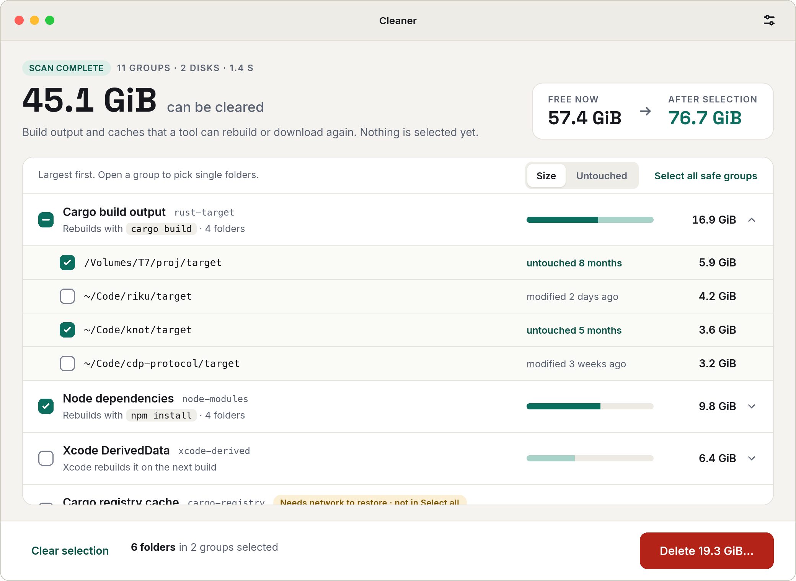
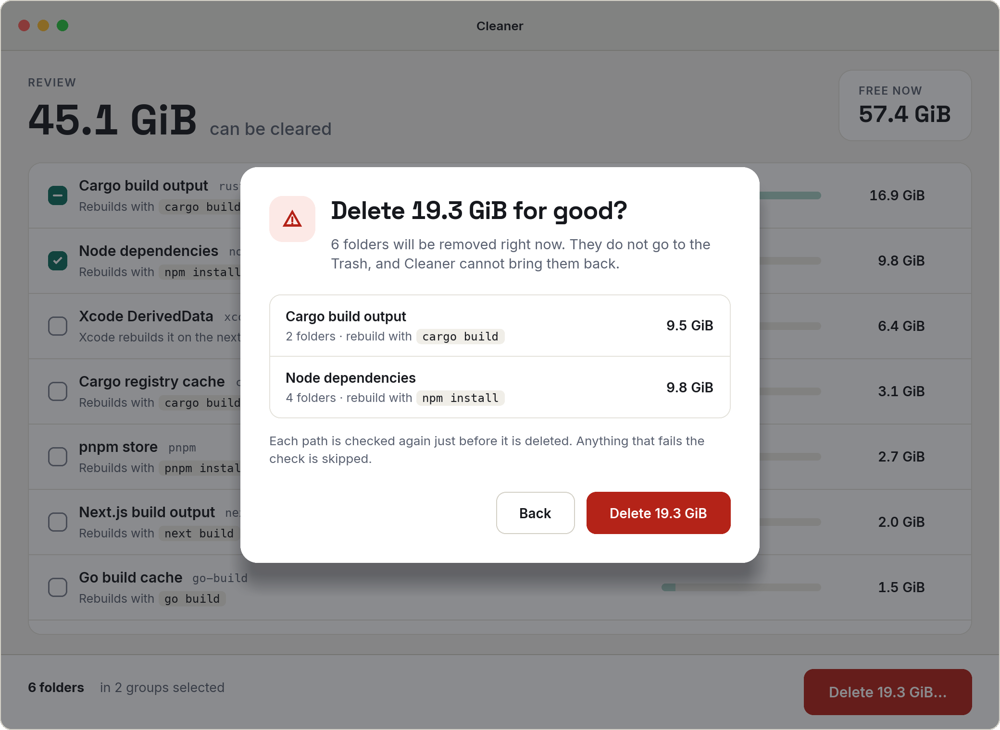
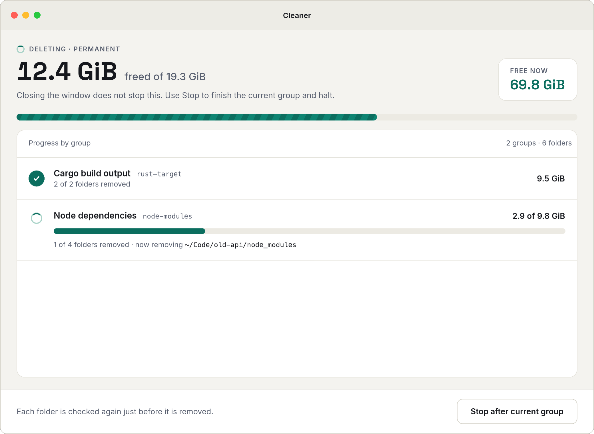
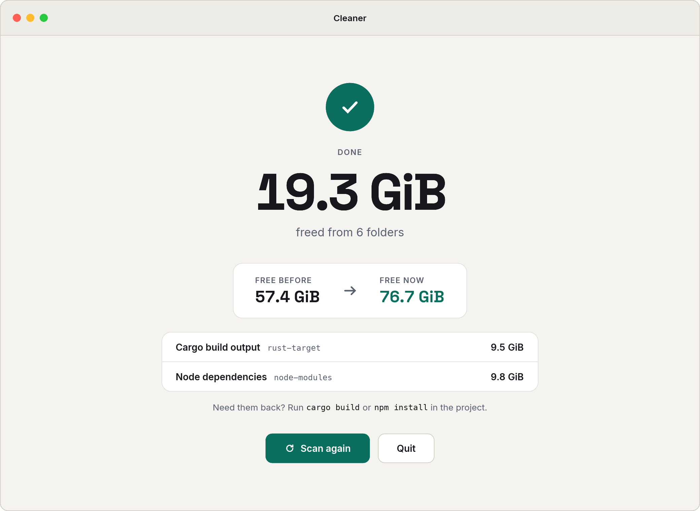
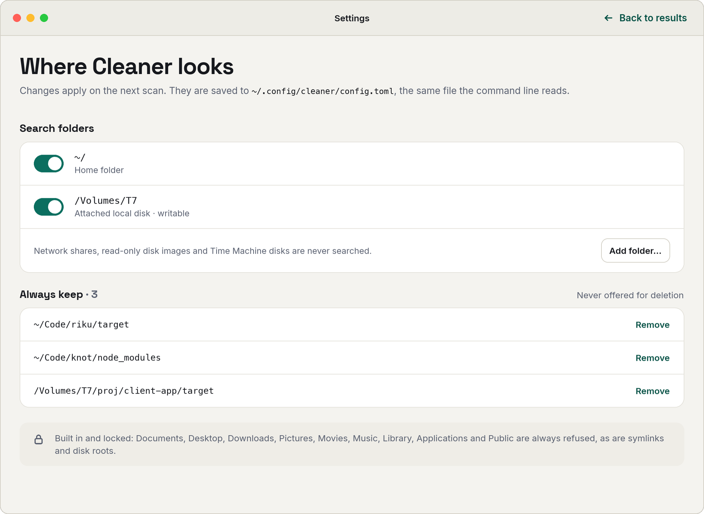

# Cleaner

A disk reclaimer for macOS development machines. It finds build output,
package caches, and downloaded dependencies (the things a tool can rebuild),
measures them, and deletes only what you approve.

It does not touch source code, browser profiles, container volumes, or
anything outside your home directory and attached local disks.

It comes as a window app (`Cleaner.app`) and a command line tool
(`cleaner`). Both are written in Rust; the window is built with Slint and
drives the same engine through `cleaner --json`. [`go/`](go/) keeps the
earlier Go build as a reference for `make compare`.



| Confirm | Deleting |
| --- | --- |
|  |  |
| **Done** | **Settings** |
|  |  |

## Install

With Homebrew, this installs `Cleaner.app` and puts `cleaner` on your PATH.
Apple Silicon only for now. The cask lives in this repo, so tap it by URL.
Homebrew asks you to trust a third party tap once before it installs from it:

```sh
brew tap dreygur/cleaner https://github.com/dreygur/cleaner
brew trust dreygur/cleaner
brew install --cask dreygur/cleaner/cleaner
```

The app is signed ad hoc, not with an Apple Developer ID, so macOS would
block a downloaded copy. The cask clears the quarantine flag after install.
If you download the zip from [Releases](https://github.com/dreygur/cleaner/releases)
yourself, do the same:

```sh
xattr -dr com.apple.quarantine /Applications/Cleaner.app
```

From source:

```sh
git clone git@github.com:dreygur/cleaner.git
cd cleaner
make install-app      # builds Cleaner.app into /Applications
make install          # builds the CLI into ~/.local/bin/cleaner
```

## Usage

Scan and report, delete nothing:

```sh
cleaner --dry-run
```

Scan, then confirm each group interactively:

```sh
cleaner
```

Delete every matched group without prompting:

```sh
cleaner --yes
```

List every rule without scanning:

```sh
cleaner --list-rules
```

| Flag | Effect |
| --- | --- |
| `--dry-run` | Report what would be deleted, then exit |
| `--yes` | Delete every matched group without prompting |
| `--only a,b` | Run only these rule ids |
| `--skip a,b` | Leave these rule ids alone |
| `--roots a,b` | Search these directories instead of the defaults |
| `--list-rules` | Print every rule id, then exit |
| `--version` | Print the version, then exit |

## Rules

Each rule targets one class of reclaimable data and carries its own
regeneration note, shown alongside its size in every report.

| Id | What it removes | How it comes back |
| --- | --- | --- |
| `rust-target` | Cargo build output | `cargo build` |
| `node-modules` | Installed npm dependencies | `npm install` / `pnpm install` |
| `next-build` | Next.js build output | `next build` |
| `pycache` | Compiled Python bytecode | Regenerated on next import |
| `go-build` | Go build cache | `go build` |
| `pnpm-store` | pnpm package store | `pnpm install` |
| `brew-cache` | Downloaded Homebrew bottles | Refetched on demand |
| `pip-cache` | pip wheel cache | Refetched on next install |
| `js-tool-cache` | node-gyp and TypeScript caches | Refetched on demand |
| `chrome-cache` | Chrome on-disk HTTP cache (profile untouched) | Refills as you browse |
| `cargo-registry` | Downloaded crate sources | `cargo fetch` (needs network) |
| `xcode-derived` | Xcode DerivedData | Rebuilt by Xcode |
| `trash` | Trash | Nothing, this is a permanent delete |

Build artifacts are searched across your whole home directory and every
attached disk under `/Volumes` that is local and writable, so external and
removable drives are included. Override with `--roots`.

The search stays out of:

- `~/Library`, `~/Applications`, `~/Pictures`, `~/Movies`, `~/Music`,
  `~/Public`, and the Go module cache in `~/go/pkg`
- hidden directories directly under a search root (`~/.nvm`, `~/.cargo`),
  whose dependencies belong to installed tools; hidden directories deeper in
  a project are searched
- every `.git` directory
- other filesystems mounted inside a root, such as `~/OrbStack`
- network shares, read only disk images, and Time Machine disks

## Safety

Deletion is permanent, nothing is moved to Trash first. The guards below
are enforced on every path, immediately before it is removed:

- Paths outside `$HOME` and the attached disks found at startup are
  rejected.
- `$HOME` itself is rejected, as are `Documents`, `Desktop`, `Downloads`,
  `Pictures`, `Movies`, `Music`, `Library`, `Applications`, and `Public`.
- The root of an attached disk is rejected.
- Symlinks are rejected, so a link can never be followed somewhere it
  should not reach.
- `target`, `node_modules`, and `.next` match only when the expected marker
  file (`Cargo.toml` or `package.json`) sits beside them. A directory named
  `target` in a notes folder is left alone.
- Cache directories are emptied but kept, so the owning tool still finds
  them. Build artifact directories are removed whole, since they are
  recreated as a unit.
- A failure on one path does not stop the remaining paths in its group.

Chrome's *profile* (history, passwords, extensions) and container or VM
volumes are deliberately outside every rule.

## Reported sizes

Sizes are the sum of apparent file sizes. On APFS, sparse files and
transparent compression mean the space actually reclaimed can be somewhat
lower than the figure in the report.

## Development

```sh
make test     # cargo test
make lint     # cargo clippy
make build    # builds target/release/cleaner
make ui       # builds and opens the window
make package  # dist/Cleaner.app, the release zip and Casks/cleaner.rb
make compare  # benchmarks the Rust build against the Go build in go/
```

## License

MIT, see [LICENSE](LICENSE).
